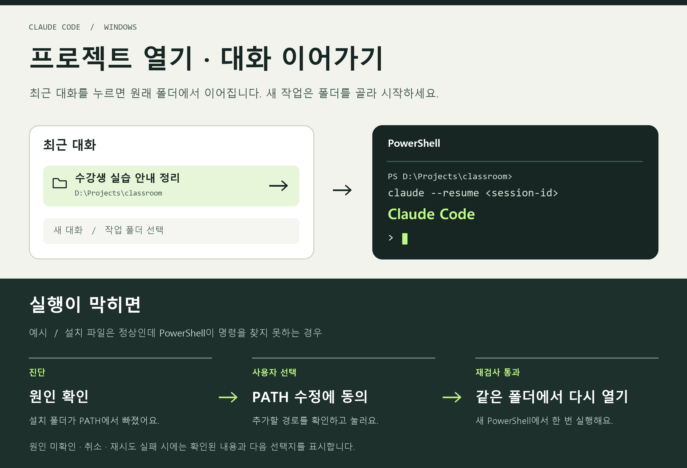

# Claude Code CLI Setup & Diagnostics

Windows에서 Claude Code 대화를 이어 열거나 작업 폴더를 선택해 새 대화를 시작하는 런처입니다. 시작에 실패하면 확인한 원인과 가능한 조치를 보여줍니다.



[화면 흐름과 진단 분기](docs/workflow.md) · [개발 순서와 검수 기준](docs/development-plan.md)

## 사용 방법

1. Windows x64용 `ClaudeLauncher.exe`를 엽니다.
2. 이전 대화는 첫 사용자 메시지와 폴더를 보고 선택합니다. 새 대화는 경로를 입력하거나 폴더를 찾아 엽니다.
3. 세션 기록을 읽지 못했다면 CLI 선택기에서 대화를 고릅니다. 런처가 작업 폴더를 물으면 해당 대화를 진행했던 폴더를 선택합니다.
4. CLI 설치나 사용자 PATH 수정이 필요하면 화면에서 변경 내용을 확인하고 적용합니다. 실제 대화와 로그인은 PowerShell에서 진행합니다.

한국어, 영어, 중국어 간체, 일본어를 지원합니다. 세션 목록은 Claude 설정 폴더의 `projects` 아래 JSONL에서 읽습니다. 대화 시각은 세션 파일의 마지막 수정 시각입니다.

## Windows 빌드

.NET 10 SDK가 있는 Windows에서 저장소 루트를 열고 실행합니다.

```powershell
dotnet publish src/ClaudeLauncher.csproj -c Release -r win-x64 -p:PublishProfile=Windows-x64
```

생성되는 파일은 `artifacts/publish/win-x64/ClaudeLauncher.exe`입니다. 런처에는 .NET 데스크톱 런타임이 포함됩니다. Claude Code 설치에는 WinGet을 사용합니다.
