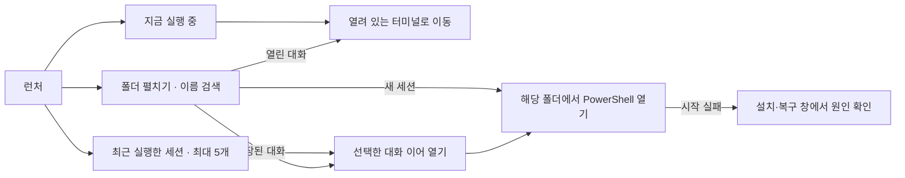
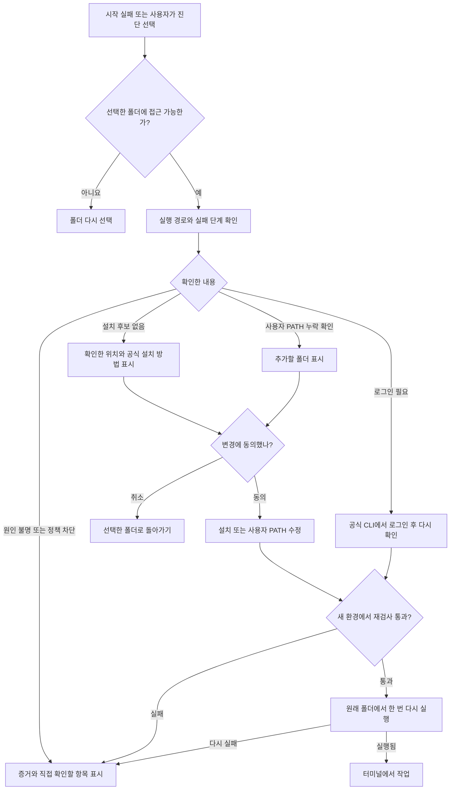
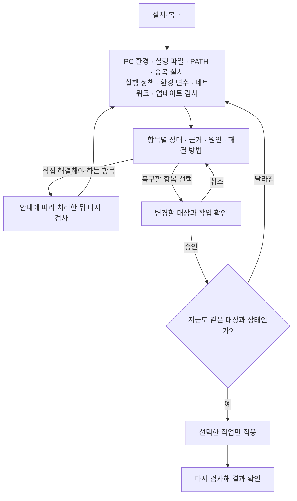

# 런처에서 프로젝트 열기

런처에서 이전 대화를 선택하면 그 대화를 진행했던 폴더에 PowerShell이 열린다. 새 작업을 시작할 때는 폴더를 선택한다.

왼쪽 또는 오른쪽 고정을 누르면 런처가 현재 모니터의 가장자리로 이동한다. 사이드바는 일반 창처럼 다른 창과 겹칠 수 있다. 고정을 해제하면 런처가 원래 위치와 크기로 돌아온다.

## 처음 여는 폴더와 최근 폴더

| 화면에서 보이는 것 | 클릭하면 일어나는 일 |
|---|---|
| 지금 실행 중 | 세션의 활동 상태를 확인하고 해당 터미널로 이동한다. 활동 신호를 읽지 못하면 상태를 확인할 수 없다고 표시한다. |
| 최근 실행한 세션 | 현재 실행 중인 대화를 제외하고 최대 5개를 표시한다. 선택하면 작업 폴더에서 `claude --resume <세션ID>`로 이어 연다. |
| 읽지 못한 대화 기록 | 정상적으로 읽은 대화는 계속 선택할 수 있다. 폴더를 고르고 CLI의 세션 선택기(`claude -r`)에서 대화를 찾는다. |
| 폴더 및 세션 | 폴더를 펼쳐 대화를 선택하거나 해당 위치에서 새 대화를 연다. 이름이 같은 폴더는 전체 경로로 구분한다. |
| 경로 입력 · 폴더 찾아보기 | 경로가 실제 폴더이고 접근 가능한지 확인한 뒤 연다. 이동했거나 삭제된 폴더는 새 위치를 선택할 수 있다. |
| 최근 기록 없음 | 폴더 선택과 새 설치를 제공한다. 기록만 보고 설치 여부를 판단하면 기존 사용자가 재설치를 안내받을 수 있다. |
| Claude Code 설치 | 지원하는 설치 방식을 먼저 확인한다. 기존 설치가 작동하면 바로 폴더를 고른다. 새 설치를 마쳤을 때 이미 고른 폴더가 있으면 그곳에서 연다. |
| 이 폴더 진단 | 터미널은 열렸지만 로그인이 멈추는 등 사용 중 문제가 있을 때 해당 폴더와 실행 환경을 다시 검사한다. |

세션 목록의 원본은 Claude 설정 디렉터리 아래 `projects/`의 JSONL 파일이다. 기록의 `cwd`를 기준으로 세션을 폴더에 묶는다. 저장된 제목을 우선 표시하고 제목이 없으면 첫 사용자 메시지를 쓴다. 빈 대화와 서브에이전트 기록은 목록에서 제외한다. 좌우 사이드바에서는 실행 중인 세션, 최근 세션, 폴더 순으로 위에서 아래로 읽는다.

런처가 여는 PowerShell마다 별도의 콘솔 창이 생긴다. 런처 밖에서 시작한 CLI도 로컬 상태 기록과 실행 중인 프로세스가 일치하면 목록에 표시한다. 외부 Windows Terminal 탭처럼 정확한 창을 식별할 수 없는 환경에서는 작업 표시줄에서 직접 전환하도록 안내한다.

활동 배지는 CLI가 기록한 상태에 따라 바뀐다. 일하는 동안에는 **작업 중**, 다음 지시를 기다릴 때는 **대기 중**이다. 권한 승인이나 질문에 대한 답이 필요한 경우에는 CLI에서 그 사유를 확인할 수 있을 때 **승인 필요** 또는 **답변 필요**로 표시한다.

## 어떤 명령으로 열리나

| 사용자가 고른 항목 | PowerShell 작업 폴더 | Claude Code 명령 |
|---|---|---|
| 새 작업 폴더 | 사용자가 입력하거나 선택한 경로 | `claude` |
| 최근 대화 제목 | 해당 세션 JSONL에서 읽은 `cwd` | `claude --resume <세션ID>` |
| 손상된 기록의 대화 선택기 | 알아낸 `cwd` 또는 사용자가 지정한 폴더 | `claude -r` |

설치·복구를 거치는 동안에도 이 선택을 보존한다. 예를 들어 ‘교육 실습’의 대화를 눌렀다면 PATH 수정 후 같은 세션 ID로 한 번 다시 연다.

## 실행에 실패하면

예를 들어 사용자가 ‘교육 실습’을 골랐는데 PowerShell이 `claude`를 찾지 못했다. 실행 파일을 직접 열면 버전 확인에 성공하고 사용자 PATH에는 설치 폴더가 없다. 결과 화면에는 추가할 경로와 **PATH 수정하고 ‘교육 실습’에서 다시 열기** 버튼을 보여준다. 이미 저장된 PATH가 정상이고 새 환경에서 실행된다면 새 터미널을 열도록 안내한다.

실행 파일의 위치, 셸이 찾은 명령, 종료 코드 등 관측한 사실을 근거로 원인을 설명한다. 단순한 시간 초과나 창 닫힘은 별도로 표시한다. 로그인 여부는 지원 버전에서 `claude auth status`로 확인한다. 계정이나 토큰 입력은 공식 CLI에서 진행한다. 공유할 진단 요약에는 대화 내용과 자격 증명을 담지 않는다. [Claude Code CLI 명령](https://code.claude.com/docs/en/cli-reference)

## 설치·복구에서 전체 검사하기

빠른 진단은 CLI를 시작하지 못한 원인을 찾는다. 전체 검사는 PC에 남은 이전 설치와 설정, 외부 서버 연결까지 확인한다. 한 항목을 고치기로 한 동의는 다른 항목에 적용되지 않는다.
