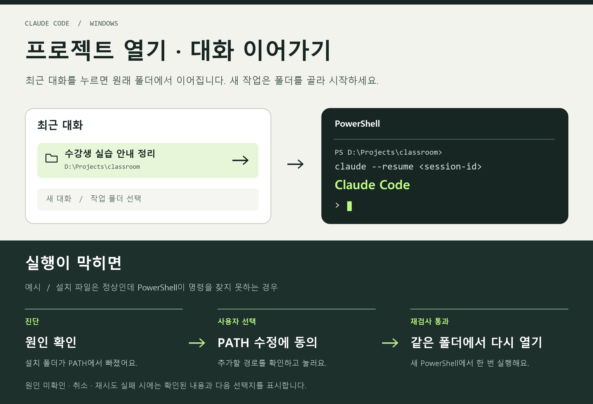
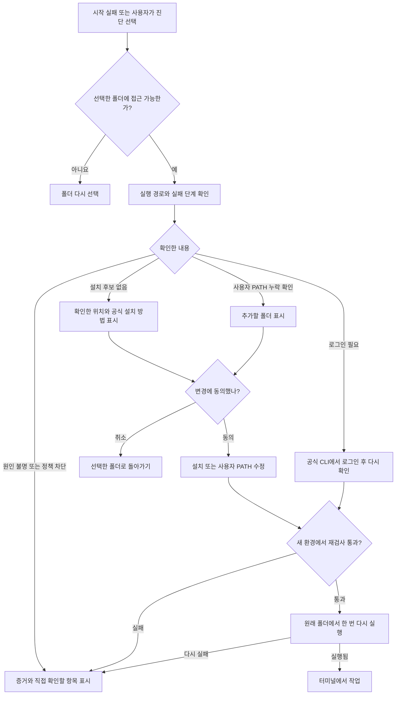

# 런처에서 프로젝트 열기

런처에서 이전 대화를 선택하면 그 대화를 진행했던 폴더에 PowerShell이 열린다. 새 작업을 시작할 때는 폴더를 선택한다.

## 처음 여는 폴더와 최근 폴더

| 화면에서 보이는 것 | 클릭하면 일어나는 일 |
|---|---|
| 최근 대화 | 첫 사용자 메시지가 제목이다. 파일을 마지막으로 수정한 시각과 작업 폴더를 함께 표시한다. 선택하면 그 폴더에서 `claude --resume <세션ID>`로 이어 연다. |
| 읽지 못한 대화 기록 | 정상적으로 읽은 대화는 계속 선택할 수 있다. 폴더를 고르고 CLI의 세션 선택기(`claude -r`)에서 대화를 찾는다. |
| 최근 폴더 이름과 전체 경로 | 해당 위치에서 새 Claude Code 대화를 연다. 이름이 같은 폴더는 전체 경로로 구분한다. |
| 경로 입력 · 폴더 찾아보기 | 경로가 실제 폴더이고 접근 가능한지 확인한 뒤 연다. 이동했거나 삭제된 폴더는 새 위치를 선택할 수 있다. |
| 최근 기록 없음 | 폴더 선택과 새 설치를 제공한다. 기록만 보고 설치 여부를 판단하면 기존 사용자가 재설치를 안내받을 수 있다. |
| Claude Code 설치 | 지원하는 설치 방식을 먼저 확인한다. 기존 설치가 작동하면 바로 폴더를 고른다. 새 설치를 마쳤을 때 이미 고른 폴더가 있으면 그곳에서 연다. |
| 이 폴더 진단 | 터미널은 열렸지만 로그인이 멈추는 등 사용 중 문제가 있을 때 해당 폴더와 실행 환경을 다시 검사한다. |

세션 목록의 원본은 Claude 설정 디렉터리 아래 `projects/`의 JSONL 파일이다. 작업 폴더는 기록의 `cwd`로 식별한다. 첫 사용자 메시지가 없는 빈 대화와 서브에이전트 기록은 목록에서 제외한다. 사용자가 선택한 대화의 제목은 로컬 화면에만 표시한다.

## 어떤 명령으로 열리나

| 사용자가 고른 항목 | PowerShell 작업 폴더 | Claude Code 명령 |
|---|---|---|
| 새 작업 폴더 | 사용자가 입력하거나 선택한 경로 | `claude` |
| 최근 대화 제목 | 해당 세션 JSONL에서 읽은 `cwd` | `claude --resume <세션ID>` |
| 손상된 기록의 대화 선택기 | 알아낸 `cwd` 또는 사용자가 지정한 폴더 | `claude -r` |

설치·복구를 거치는 동안에도 이 선택을 보존한다. 예를 들어 ‘교육 실습’의 대화를 눌렀다면 PATH 수정 후 같은 세션 ID로 한 번 다시 연다.

## 실행에 실패하면

예를 들어 사용자가 ‘교육 실습’을 골랐는데 PowerShell이 `claude`를 찾지 못했다. 실행 파일을 직접 열면 버전 확인에 성공하고 사용자 PATH에는 설치 폴더가 없다. 결과 화면에는 추가할 경로와 **PATH 수정하고 ‘교육 실습’에서 다시 열기** 버튼을 보여준다. 이미 저장된 PATH가 정상이고 새 환경에서 실행된다면 새 터미널을 열도록 안내한다.

실행 파일의 위치, 셸이 찾은 명령, 종료 코드 등 관측한 사실을 근거로 원인을 설명한다. 단순한 시간 초과나 창 닫힘은 별도로 표시한다. 로그인 여부는 지원 버전에서 `claude auth status`로 확인한다. 계정이나 토큰 입력은 공식 CLI에서 진행한다. 공유할 진단 요약에는 대화 내용과 자격 증명을 담지 않는다. [Claude Code CLI 명령](https://code.claude.com/docs/en/cli-reference)

첫 버전에서 자동으로 적용할 조치는 사용자 범위의 공식 설치와 확인된 PATH 누락 수정이다. 기업 정책에 막히면 확인된 기록과 담당자에게 전달할 내용을 보여준다. 재검사나 재실행이 실패하면 실패 단계를 화면에 남기고 사용자의 다음 선택을 기다린다.
