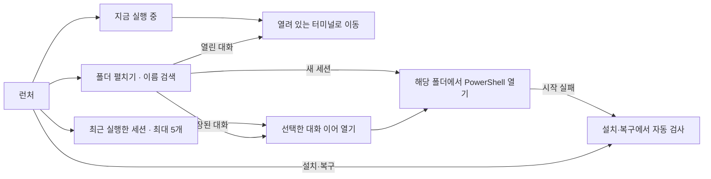
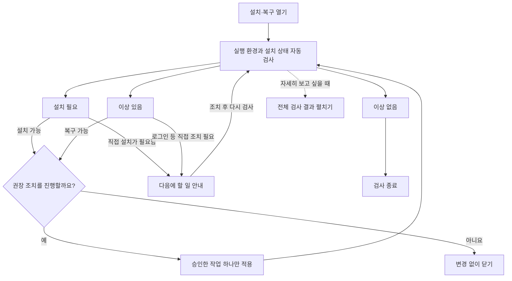

# 런처에서 프로젝트 열기

런처에서 이전 대화를 선택하면 그 대화를 진행했던 폴더에 PowerShell이 열린다. 새 작업을 시작할 때는 폴더를 선택한다.

왼쪽 또는 오른쪽 고정을 누르면 런처가 현재 모니터의 가장자리로 이동한다. 사이드바는 일반 창처럼 다른 창과 겹칠 수 있다. 고정을 해제하면 런처가 원래 위치와 크기로 돌아온다.



## 처음 여는 폴더와 최근 폴더

| 화면에서 보이는 것 | 클릭하면 일어나는 일 |
|---|---|
| 지금 실행 중 | 세션의 활동 상태를 확인하고 해당 터미널로 이동한다. 활동 신호를 읽지 못하면 상태를 확인할 수 없다고 표시한다. |
| 최근 실행한 세션 | 현재 실행 중인 대화를 제외하고 최대 5개를 표시한다. 선택하면 작업 폴더에서 `claude --resume <세션ID>`로 이어 연다. |
| 읽지 못한 대화 기록 | 정상적으로 읽은 대화는 계속 선택할 수 있다. 폴더를 고르고 CLI의 세션 선택기(`claude -r`)에서 대화를 찾는다. |
| 폴더 및 세션 | 폴더를 펼쳐 대화를 선택하거나 해당 위치에서 새 대화를 연다. 이름이 같은 폴더는 전체 경로로 구분한다. |
| 경로 입력 · 폴더 찾아보기 | 경로가 실제 폴더이고 접근 가능한지 확인한 뒤 연다. 이동했거나 삭제된 폴더는 새 위치를 선택할 수 있다. |
| 최근 기록 없음 | 폴더를 골라 새 대화를 시작할 수 있다. CLI 설치 여부는 설치·복구에서 확인한다. |
| 설치·복구 | 설치 여부와 실행 상태를 확인한다. 설치나 복구가 필요하면 원인과 권장 조치를 보여준다. |
| 이 폴더 진단 | 터미널은 열렸지만 로그인이 멈추는 등 사용 중 문제가 있을 때 해당 폴더와 실행 환경을 다시 검사한다. |

세션 목록의 원본은 Claude 설정 디렉터리 아래 `projects/`의 JSONL 파일이다. 기록의 `cwd`를 기준으로 세션을 폴더에 묶는다. 저장된 제목을 우선 표시하고 제목이 없으면 첫 사용자 메시지를 쓴다. 빈 대화와 서브에이전트 기록은 목록에서 제외한다. 좌우 사이드바에서는 실행 중인 세션, 최근 세션, 폴더 순으로 위에서 아래로 읽는다.

런처가 여는 PowerShell마다 별도의 콘솔 창이 생긴다. 런처 밖에서 시작한 CLI도 로컬 상태 기록과 실행 중인 프로세스가 일치하면 목록에 표시한다. 외부 Windows Terminal 탭처럼 정확한 창을 식별할 수 없는 환경에서는 작업 표시줄에서 직접 전환하도록 안내한다.

활동 배지는 CLI가 기록한 상태에 따라 바뀐다. 일하는 동안에는 **작업 중**, 다음 지시를 기다릴 때는 **대기 중**이다. 권한 승인이나 질문에 대한 답이 필요한 경우에는 CLI에서 그 사유를 확인할 수 있을 때 **승인 필요** 또는 **답변 필요**로 표시한다.

## 어떤 명령으로 열리나

| 사용자가 고른 항목 | PowerShell 작업 폴더 | Claude Code 명령 |
|---|---|---|
| 새 작업 폴더 | 사용자가 입력하거나 선택한 경로 | `claude` |
| 최근 대화 제목 | 해당 세션 JSONL에서 읽은 `cwd` | `claude --resume <세션ID>` |
| 손상된 기록의 대화 선택기 | 알아낸 `cwd` 또는 사용자가 지정한 폴더 | `claude -r` |

## 설치·복구를 열면

**설치·복구**를 누르면 런처가 선택한 폴더의 실행 환경과 PC의 설치 상태를 함께 검사한다. 첫 화면에는 **설치 필요**, **이상 있음**, **이상 없음** 중 하나가 뜬다. 이상이 있으면 상태를 빨간색으로 표시한다.

예를 들어 `~/.local/bin/claude.exe`가 사라졌고 서명이 유효한 백업이 여러 개 남아 있다고 하자. 다른 경로에도 정상 설치본이 없다면, 런처는 **이상 있음**을 표시하고 복원할 백업 하나를 골라 제안한다. **예**를 누르면 실행 파일을 복원하고 다시 검사한다. **아니요**를 누르면 변경 없이 닫힌다.



**전체 검사 결과**는 처음에는 접혀 있다. 펼치면 여덟 단계에서 확인한 경로와 설정, 판정 근거를 볼 수 있다. 권장 조치 외에 다른 작업을 직접 선택하면 무엇을 바꿀지 확인한 뒤 진행한다. 한 작업을 승인해도 다른 작업까지 함께 실행하지 않는다.

### 설치 방법을 선택하는 기준

실행 파일만 사라졌다면 검증된 백업 복원을 먼저 제안한다. 처음 설치하거나 복원할 백업이 없어 재설치할 때는 공식 PowerShell 설치 명령을 쓴다. 런처는 승인 화면에서 이 명령과 WinGet으로 넘어가는 조건을 함께 안내한다. **예** 한 번으로 이 설치 시도를 승인한다. [Anthropic 공식 설치 안내](https://code.claude.com/docs/en/setup#install-claude-code)

```powershell
irm https://claude.ai/install.ps1 | iex
```

공식 설치 프로그램은 다운로드 중에 아무것도 출력하지 않을 수 있다. 런처는 설치 프로그램의 출력과 다운로드 파일의 변화를 확인한다. 둘 다 5분 연속 관찰되지 않고 기존 설치 프로세스를 안전하게 멈춘 경우에만 WinGet을 시도한다. 설치 오류, 취소, 설치 후 검증 실패는 결과에 표시하고 해당 시도를 끝낸다.

## 세션을 열다가 실패한 경우

런처는 처음 선택한 폴더와 세션 ID를 기억한다. 예를 들어 ‘교육 실습’ 세션을 열었는데 PowerShell이 `claude`를 찾지 못했다고 하자. 확인된 설치 폴더가 사용자 PATH에서 빠졌다면, 결과 화면에는 원인과 그 폴더를 PATH에 추가할지 묻는 질문이 뜬다. **예**를 눌러 수정한 뒤 재검사에서 실행할 수 있다고 확인되면 **같은 폴더에서 다시 시도**로 원래 대화를 이어 연다.

| 실행할 수 없는 이유 | 다음에 할 일 |
|---|---|
| 작업 폴더가 이동했거나 삭제됨 | 런처에서 현재 폴더를 다시 선택한다. |
| 로그인이 필요함 | PowerShell에서 `claude auth login`으로 로그인하고 다시 검사한다. 로그인 정보는 공식 CLI에 입력한다. |
| 조직 정책이나 네트워크 설정을 직접 바꿔야 함 | 결과에 나온 안내를 확인한다. 관리자에게 문의할 때는 전체 검사 결과에서 해당 항목의 근거를 볼 수 있다. |
| CLI가 시작된 뒤 오류로 종료됨 | 런처가 확인한 종료 코드와 진단 내용을 확인한다. |

로그인 여부는 지원 버전에서 `claude auth status`로 확인한다. 공유할 진단 요약에는 대화 내용과 자격 증명을 담지 않는다. [Claude Code CLI 명령](https://code.claude.com/docs/en/cli-reference)
